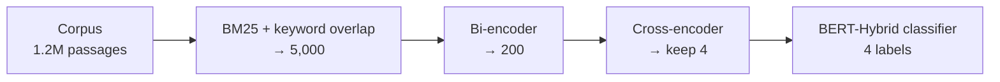
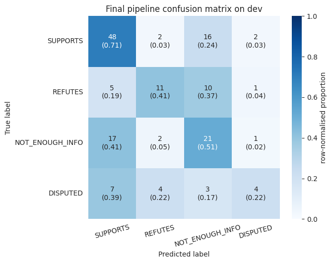

# Climate Fact-Checking

Given a climate claim, the system retrieves evidence from a 1.2M-passage corpus and labels the claim **SUPPORTS**, **REFUTES**, **NOT_ENOUGH_INFO** or **DISPUTED**. It was built as a group NLP project at the University of Melbourne (2026) and includes a FastAPI demo service.

## Method



- **Shortlisting:** `bm25s` (k1 = 1.2, b = 0.75). Candidates are scored as `z(BM25) + α·overlap`, where overlap is spaCy keyword overlap with entities weighted 2×. α is tuned on dev.
- **Bi-encoder** (`all-MiniLM-L6-v2`): trained with an in-batch contrastive loss plus a resampled hard negative per claim.
- **Cross-encoder** (`ms-marco-MiniLM-L-6-v2`): trained with a pairwise hinge loss on bi-encoder hard negatives.
- **BERT-Hybrid classifier:** RoBERTa-base encodes the claim and the evidence separately, then a 2-layer Transformer decoder fuses them. It is trained on both gold and retrieved evidence. Class weighting is chosen on dev.

## Results (dev)

| Retrieval stage | R@4 | R@10 | F1@4 |
|---|---|---|---|
| BM25 + keyword overlap | 0.130 | 0.200 | 0.118 |
| + Bi-encoder | 0.232 | 0.346 | 0.201 |
| + Cross-encoder | 0.261 | 0.395 | 0.231 |

| Classifier (gold evidence) | Accuracy | Macro-F1 | HM |
|---|---|---|---|
| Baseline Transformer | 0.383 | 0.330 | 0.354 |
| ConcatRoBERTa | 0.533 | 0.485 | 0.508 |
| **BERT-Hybrid** | **0.552** | **0.489** | **0.518** |

| End-to-end | Evidence F | Accuracy | HM |
|---|---|---|---|
| Dev | 0.231 | 0.546 | 0.325 |
| Test (rounded) | 0.22 | 0.50 | 0.31 |

Retrieval is the bottleneck: at least one gold passage was found for only 86 of 154 dev claims. DISPUTED is the hardest class (4/18 correct).



## Structure

```
src/factcheck/  paths, text cleaning, keyword fusion, metrics
notebooks/      01 preprocess → 02 shortlist → 03 rerank → 04 classify → 05 end-to-end
app/            FastAPI service + web UI (BM25 → public cross-encoder → zero-shot NLI label)
data/           claim files (evidence.json not included, ~166 MB)
scripts/        corpus subsetting    tests/  pytest
```

## Run

```bash
pip install -r requirements.txt && python -m spacy download en_core_web_sm
# Place evidence.json in data/, or set FACTCHECK_DATA_DIR / FACTCHECK_WORK_DIR, then run notebooks 01–05 in order (GPU recommended).

pip install -r requirements-service.txt
uvicorn app.main:app --port 8000   # web UI; falls back to data/sample_evidence.json (synthetic DEMO passages)
docker compose up --build
pytest -q
```

The service never predicts DISPUTED, because its labels come from a zero-shot NLI model rather than the trained classifier. Service settings (`EVIDENCE_PATH`, `TOP_K`, `CROSS_MODEL`, `NLI_MODEL`, `MODEL_DIR`) are listed in `app/config.py`.
